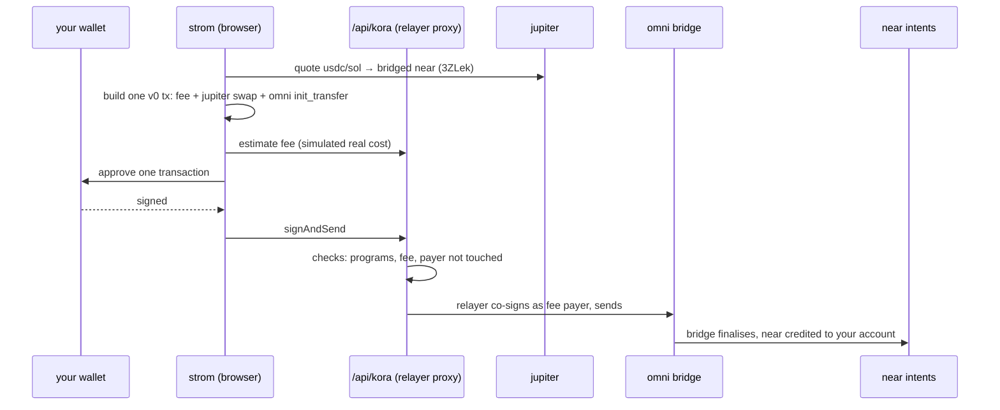

# strom

**move usdc and sol from solana to near in one signature. no gas token needed.**

strom by seedless · live at **[strom.seedlesslabs.xyz](https://strom.seedlesslabs.xyz)** · installable as an app (pwa)

---

## the problem

moving money from solana to near today takes three apps and four steps: swap on a dex, find a bridge, pay gas on both sides, then wait and hope it lands. you also need sol in your wallet for gas before you can move anything at all.

strom turns that into one screen and one approval:

- **one signature.** the swap, the fee and the bridge transfer ride in a single solana transaction.
- **no gas token.** a relayer pays the solana network fee. you pay it back out of what you send: in usdc if you send usdc, in sol if you send sol.
- **non-custodial.** strom never holds your money and never signs for you. your wallet approves every move, and funds go from your wallet straight to your near account.
- **plain words.** a small ai layer turns "swap 10 usdc to near" into a filled-in swap. it reads only. you still approve in your wallet.
- **both ways.** near back to sol on solana goes through near intents and 1click, also with one approval.

## proven on mainnet

| run | what happened |
|---|---|
| usdc → near | swap, usdc fee and bridge transfer in one tx. finalised on near in 81s, 0.2703 near on the user's intents account at 84s. user sol spent: 0 |
| sol → near | 0.001 sol in. fee 0.00012 sol paid in sol, no usdc held. tx [`44EH2Y…qKq6`](https://solscan.io/tx/44EH2Y6cGR44GXMXopUtdqbJ7dLvQ6pzSVeEW5msA6KqGJuDgC5JMkPJ5YAtGRuW9SjzPrnD13xgXpafWXRqQKq6), 1151 bytes. +0.0202 near on intents 87s later |
| near → sol | 0.2703 near → 0.0116 sol back in the solana wallet in 114s, one signed intent. tx [`5qmy…7GyG`](https://solscan.io/tx/5qmymZa4Qhk2fEw2kpwvAx1hHhQjkoozCuSzG6M2gD35BMn18hVeR8u6VtnBdzVBYw6ZbfEmvGQxk6XkPutw7GyG) |

## how a swap works

### solana → near (one solana transaction)



1. **quote.** jupiter quotes your usdc or sol into near as it lives on solana (mint `3ZLek…9wBG`, bridged by the [omni bridge](https://github.com/Near-One/omni-bridge)).
2. **build.** `src/lib/buildSwap.ts` puts three things in one transaction:
   - the relayer fee (a usdc transfer, or a sol transfer when sol goes in)
   - the jupiter swap instructions
   - omni `init_transfer` to near, with the bridge fee taken out of the bridged near, so you need no native token on either side
3. **fit.** solana caps a transaction at 1232 bytes. strom compresses accounts with jupiter's lookup tables plus its own ([`6wsh…21iZi`](https://solscan.io/account/6wshRpSHFpzY3aZ9eM9hJHKJPmqbYv9TYy6nUbZ21iZi)). if a route is still too big, it asks jupiter for a smaller one, down to a single pool.
4. **sign.** your wallet signs once, through the wallet standard. any solana wallet that supports it works.
5. **send.** the relayer co-signs as fee payer and sends. the omni relayer picks up the transfer and finalises it on near. `#/track` follows it to the end.

### near → solana (one near intent)

`src/lib/near.ts`: 1click quotes near → sol, your solana wallet signs one transfer intent for your near implicit account, strom simulates it against `intents.near`, publishes it to the solver relay, and 1click delivers sol to your solana address.

### the root cause we fixed on the way

the omni relayer reads solana transactions as v0 or legacy only, and resolves the token, sender and emitter of `init_transfer` from the static account keys. a v1 transaction, or a v0 one with those accounts in a lookup table, is never indexed and the transfer sits unfinalised. strom builds v0 and masks those three accounts out of every lookup table so they stay static (`keepStatic` in `buildSwap.ts`). reported upstream: [Near-One/bridge-sdk-rs#331](https://github.com/Near-One/bridge-sdk-rs/issues/331). v1 support is kept behind `txVersion: 1` for when the relayer reads it.

## fees

| | who pays | amount |
|---|---|---|
| solana network fee | the relayer, paid back by you | simulated real cost × 1.2, never under $0.01 |
| fee currency | you choose by what you send | usdc in → usdc fee · sol in → sol fee |
| bridge fee | taken from the bridged near | quoted live by the omni api |
| swap | jupiter routing, 0.5% slippage cap | market |

below the bridge fee, strom says "amount too small" before you sign. above your balance, it says how much you can send. a small reserve (0.005 sol or 0.01 usdc) stays back for the fee.

## the relayer is guarded

the relayer pays real sol, so `api/kora.ts` only forwards a transaction that looks exactly like strom's own:

- only three methods: `getPayerSigner`, `estimateTransactionFee`, `signAndSendTransaction`
- every top-level program is on an allow list (compute budget, token, token-2022, ata, system, memo, jupiter v6, omni), and the omni bridge must be in it
- the fee payer is used for fees and nothing else: no instruction may move its funds, except to receive the wsol rent back or the sol fee
- every send must carry a fee to the payer that covers what the transaction really costs it, found by simulation
- per-ip limit (20/min), a vercel firewall rate rule on top, a body cap, a 20s upstream timeout, a daily ceiling
- the relayer key lives in server env only, never in the browser bundle

the solana rpc goes through `api/rpc.ts`, also rate limited, so the rpc key stays server-side too.

## the ai layer ("tell strom")

`#/agent` takes plain words: "swap 10 usdc to near", "how much near for 1 sol", "where is my money".

- `api/agent.ts` asks a model through vercel ai gateway for a structured intent (`kind`, `dir`, `tok`, `amt`)
- `src/lib/agent.ts` runs every answer through a guard (`clean`) and falls back to a local parser if the server is slow or down
- the result is only ever a link into strom's own swap or track page. it never signs, never sends, and refuses tokens strom does not move

## pages

| route | what it is |
|---|---|
| `#/` | home: what strom does in one screen |
| `#/swap` | the swap, both directions, with your balance and a max button |
| `#/track` | follows a transfer step by step until it lands |
| `#/agent` | tell strom in plain words |
| `#/how` | how it works, in plain english |
| `#/builders` | addresses, programs and apis, for developers |
| `#/about` | who builds it |

light and dark themes, works on a phone, installs as an app.

## code map

```
api/
  kora.ts        relayer proxy: checks, fee pricing, rate limits
  rpc.ts         solana rpc proxy, rate limited
  agent.ts       plain words → intent, via vercel ai gateway
src/lib/
  buildSwap.ts   one-tx builder: fee + jupiter + omni, v0 + lookup tables, route fallback
  omni.ts        omni init_transfer instruction, matched byte for byte to the official sdk
  jupiter.ts     quote + swap instructions
  kora.ts        relayer client, fee instructions
  near.ts        near implicit account, intents, 1click, solver relay
  flow.ts        both money flows as plain steps, balances
  agent.ts       guard + local parser
  config.ts      mints, programs, apis, limits
src/pages/       the seven pages
src/ui/          shell, lockup, prose
scripts/         checks and runs (below)
```

## run it

```bash
npm install
cp .env.example .env.local   # fill in the server-only keys if you run the api locally
npm run dev
```

`npm run build` type-checks and builds. deploys go out with `vercel --prod`.

| env | where | what |
|---|---|---|
| `VITE_SOLANA_RPC` | browser | rpc for reads (defaults to the `/api/rpc` proxy) |
| `VITE_KORA_URL` | browser | relayer url, unset = `/api/kora` |
| `VITE_NEAR_RECIPIENT` | browser | default near recipient, `intents.near` |
| `KORA_API_KEY` | server | hosted kora key. never `VITE_` |
| `KORA_UPSTREAM` | server | hosted kora url |
| `SOLANA_RPC` | server | rpc the proxies use |
| `AI_GATEWAY_API_KEY` | server | local dev only; on vercel the deployment oidc token is used |
| `STROM_GATEWAY_MODEL` | server | model id, optional |

## checks

| command | proves | cost |
|---|---|---|
| `npm run check:omni` | strom's `init_transfer` matches the official omni sdk byte for byte | no network |
| `npm run check:fork` | the full to-near tx on a local mainnet fork: build, co-sign, send | $0, throwaway keys |
| `npm run check:near` | near → sol libs against mainnet: implicit account, live quote, signed intent accepted, tampered signature rejected | read-only, nothing moves |
| `scripts/live-run.ts` | both directions with real funds, end to end | ~$1, keys kept outside the repo |

## built with

[jupiter](https://jup.ag) · [omni bridge](https://github.com/Near-One/omni-bridge) · [near intents](https://docs.near-intents.org) + 1click · [kora](https://github.com/solana-foundation/kora) via lazorkit · [@solana/kit](https://github.com/anza-xyz/kit) · wallet standard · vercel ai gateway · react + vite

## who

built by [seedless](https://seedlesslabs.xyz), the team behind the seedless money app on solana. github: [seedless-labs](https://github.com/seedless-labs).

mit license, © Seedless Labs, Inc. see [LICENSE](LICENSE).
